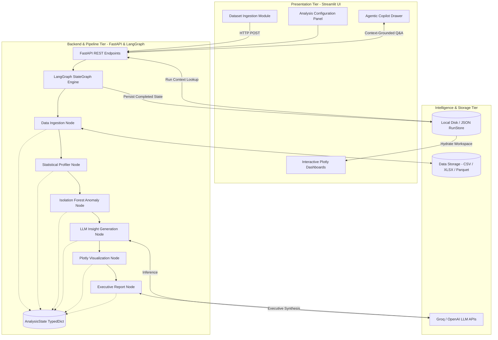

# Self-Service Analytics Copilot

<div align="center">


<p align="center">
  <b>An autonomous agentic pipeline for tabular data exploration, machine learning anomaly detection, interactive visualization synthesis, and conversational report generation.</b>
</p>

[Key Features](#-key-features) •
[Screenshots](#-screenshots) •
[System Architecture](#-system-architecture) •
[Quick Start](#-quick-start) •
[API Reference](#-api-reference) •
[Deployment](#-deployment)

---

</div>

## Overview

Modern exploratory data analysis (EDA) is often manual, repetitive, and time-consuming. When organizations dump large datasets onto non-technical stakeholders, understanding data quality, detecting anomalies, and extracting business insights creates an operational bottleneck.

**Self-Service Analytics Copilot** automates the entire analytical lifecycle:
1. **Automated Ingestion & Profiling**: Computes schema distributions, data types, missingness, and correlation matrices without human intervention.
2. **Machine Learning Anomaly Detection**: Uses **Isolation Forests** (multivariate) and **Z-score/IQR** (univariate) to flag statistical outliers.
3. **Cognitive Insight Synthesis**: Synthesizes mathematical findings into plain-English business recommendations using state-of-the-art LLMs (**Groq LLaMA 3.3 / GPT-OSS 120B** or **OpenAI GPT-4o**).
4. **Interactive Visual Dashboard**: Generates responsive **Plotly** heatmaps, box plots, and scatter distributions.
5. **Agentic Copilot (Chat Q&A)**: A conversational agent powered by tool-calling (`bind_tools`) that inspects dataset runs and answers ad-hoc questions strictly grounded in computed facts.

---

## Screenshots

<div align="center">

### 1. Interactive Analytics Dashboard
*Comprehensive multi-tab analysis showing dataset shape, data hygiene, and distribution moments.*
<br><br>


<br><br>

### 2. High-Density Profiling & Visualizations
*Interactive Plotly heatmaps, category distributions, and automated metrics.*
<br><br>


<br><br>

### 3. Agentic Analytics Copilot
*Conversational Q&A grounded in live dataset execution context with real-time tool execution.*
<br><br>


<br><br>

### 4. Executive Summary & Anomaly Cards
*Actionable business findings, risk advisories, and flagged outliers.*
<br><br>


</div>

---

## Key Features

- **Stateful Graph Orchestration (`LangGraph`)**: A resilient Directed Acyclic Graph (DAG) managing sequential data flows with conditional routing, state persistence, and automatic fallback branches.
- **Multivariate ML Outlier Isolation**: Unsupervised **Isolation Forest** algorithms combined with robust interquartile metrics to identify multi-column anomalies without ground-truth labels.
- **Agentic Tool-Calling Copilot**: The AI copilot does not guess or hallucinate numbers; it invokes targeted Python tools (`get_dataset_overview`, `get_column_statistics`, `get_outlier_analysis`) to retrieve mathematically verified results.
- **Multi-Model LLM Support**: Native plug-and-play support for **Groq** (ultra-fast, free tier with `openai/gpt-oss-120b` or `llama-3.3-70b-versatile`) and **OpenAI** (`gpt-4o`, `gpt-4o-mini`).
- **Dual Runtime Architecture**:
  - **Embedded Mode**: Run the full pipeline inside Streamlit without running a separate server.
  - **Client-Server API Mode**: Run high-performance FastAPI backends with detached asynchronous job execution.
- **Persistent Workspace RunStore**: Automatically caches past runs as JSON artifacts, enabling instant workspace hydration and historical comparison.

---

## System Architecture



---

## Repository Structure

```
Self-Service-Analytics-Copilot/
├── agents/                       # Specialized autonomous agents
│   ├── anomaly.py                # Multivariate & univariate anomaly detector
│   ├── copilot.py                # Agentic tool-calling copilot with LangChain
│   ├── insight.py                # Strategic business insight generator
│   ├── llm_utils.py              # LLM factory (Groq & OpenAI client builder)
│   ├── profiler_simple.py        # High-performance schema profiler
│   ├── reporter.py               # Executive report synthesizer
│   └── visualizer.py             # Visual recommendation planner
├── graph/                        # LangGraph workflow orchestration
│   ├── nodes.py                  # Node execution handlers & skip fallbacks
│   ├── state.py                  # TypedDict schema representing workflow state
│   └── workflow.py               # Directed graph construction & conditional edges
├── tools/                        # Functional analytics tools
│   ├── analyzer.py               # Statistical computations (IQR, Z-score, correlations)
│   ├── data_loader.py            # Encoding-aware tabular file parser
│   └── visualizer.py             # Plotly chart generation routines
├── services/                     # Storage and data services
│   └── run_store.py              # Persistent JSON workspace storage
├── doc/                          # Architecture diagrams & UI screenshots
│   ├── Dashboard.png
│   ├── Card.png
│   ├── Frontend.jpeg
│   └── Copilot.png
├── config.py                     # Central application configuration & settings
├── main.py                       # FastAPI REST API server
├── streamlit_app.py              # Streamlit interactive web frontend
├── requirements.txt              # Production dependencies
├── requirements-full.txt         # Extended dependencies
├── .env.example                  # Template for environment variables
└── README.md                     # Project documentation
```

---

## Quick Start

### 1. Clone the Repository
```bash
git clone https://github.com/fayaz786sret/Self-Service-Analytics-Copilot.git
cd Self-Service-Analytics-Copilot
```

### 2. Set Up Virtual Environment
```bash
# Windows
python -m venv .venv
.\.venv\Scripts\activate

# macOS / Linux
python3 -m venv .venv
source .venv/bin/activate
```

### 3. Install Dependencies
```bash
pip install -r requirements.txt
```

### 4. Configure Environment Variables
Copy `.env.example` to `.env`:
```bash
cp .env.example .env
```
Open `.env` and add your API key (Groq or OpenAI):
```env
# Free Groq Setup (Recommended for ultra-fast inference)
GROQ_API_KEY=gsk_your_groq_api_key_here
GROQ_MODEL=openai/gpt-oss-120b

# Or OpenAI Setup
OPENAI_API_KEY=sk-your_openai_api_key_here
OPENAI_MODEL=gpt-4o
```
*(Tip: You can obtain a free Groq API key from [console.groq.com](https://console.groq.com))*

### 5. Launch the Application

#### Option A: Run Frontend Only (Embedded Mode)
Streamlit can execute the LangGraph pipeline directly without needing the FastAPI server:
```bash
streamlit run streamlit_app.py
```
*Access the UI at: `http://localhost:8501`*

#### Option B: Run Full Client-Server Architecture (Recommended)
In **Terminal 1** (Backend):
```bash
python main.py
```
*FastAPI runs on: `http://localhost:8010` (Swagger docs available at `http://localhost:8010/docs`)*

In **Terminal 2** (Frontend):
```bash
streamlit run streamlit_app.py
```

---

## API Reference

When running `main.py`, FastAPI exposes the following REST endpoints:

| Method | Endpoint | Description |
|---|---|---|
| `GET` | `/health` | Service health status check |
| `POST` | `/analyze` | Upload a dataset multipart file and trigger graph execution |
| `GET` | `/runs` | List metadata for all past analysis runs |
| `GET` | `/runs/{run_id}` | Retrieve complete JSON state and artifacts for a specific run |
| `POST` | `/copilot/ask` | Submit ad-hoc natural language question against a saved run |

---

## Deployment

### Streamlit Community Cloud (Free)
1. Push this repository to your GitHub account.
2. Go to [share.streamlit.io](https://share.streamlit.io/) and create a **New app**.
3. Select your repository and set `streamlit_app.py` as the entrypoint.
4. Under **Advanced Settings > Secrets**, configure:
   ```toml
   GROQ_API_KEY = "your_groq_api_key"
   GROQ_MODEL = "openai/gpt-oss-120b"
   DATA_PIPELINE_MODE = "embedded"
   MAX_FILE_SIZE_MB = "200"
   ```
5. Deploy and share your live analytics workspace URL.

---

## Contributing

Contributions, feature suggestions, and bug reports are welcome!
1. Fork the Project.
2. Create your Feature Branch (`git checkout -b feature/AmazingFeature`).
3. Commit your Changes (`git commit -m 'feat: Add AmazingFeature'`).
4. Push to the Branch (`git push origin feature/AmazingFeature`).
5. Open a Pull Request.

---

## License

Distributed under the **MIT License**. See [`LICENSE`](./LICENSE) for more information.

---

<div align="center">
  <sub>Built with ❤️ using LangGraph, LangChain, FastAPI, and Streamlit.</sub>
</div>
